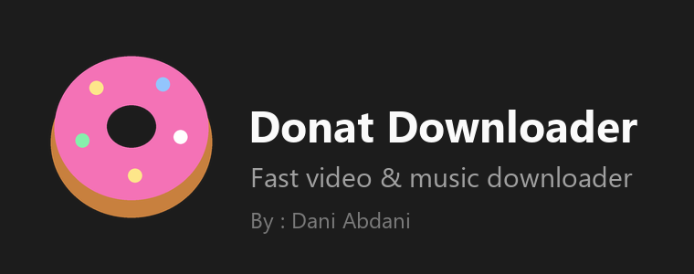
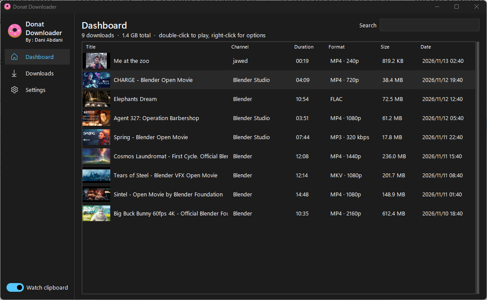
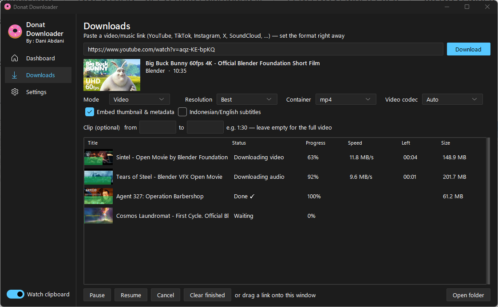
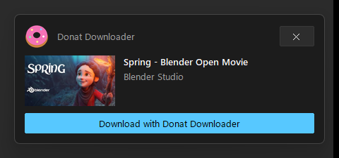
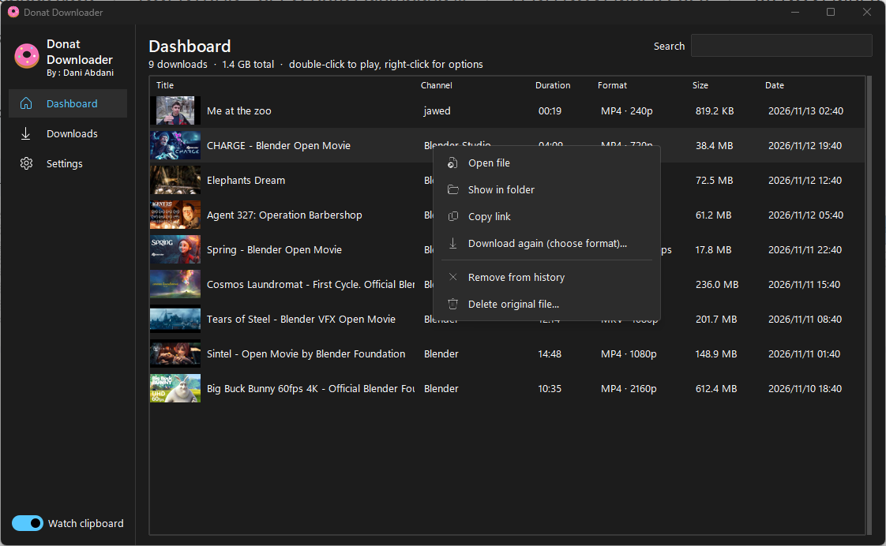
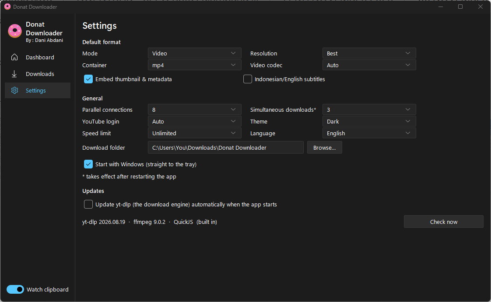
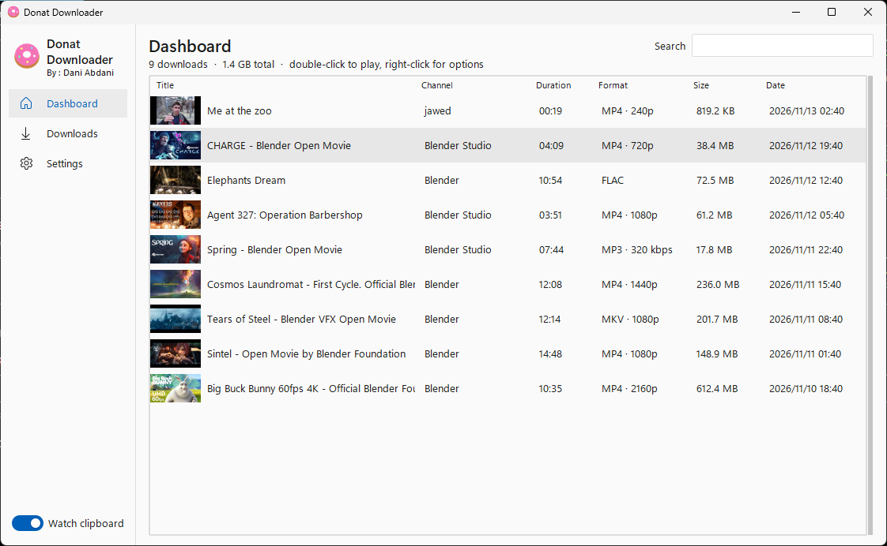

<p align="center">
  
</p>

<p align="center">
  A fast, modern downloader for video and music from YouTube and 1,700+ other sites.<br>
  Copy a link - Notif on tray, pick a format, done.
</p>

<p align="center">
  <a href="../../releases/latest"><b>Download the latest release</b></a> ·
  single <code>.exe</code>, nothing else to install ·
  <a href="https://abdani.github.io/Donat-Downloader/">Website</a>
</p>



## Features

| Feature | Details |
| --- | --- |
| **Copy → download** | Just copy a link (<kbd>Ctrl</kbd>+<kbd>C</kbd>). A notification pops up from the tray automatically. Click **Download with Donat Downloader**, pick a format, done. |
| **1,700+ sites** | YouTube, TikTok, Instagram, X, SoundCloud, Bandcamp and more, via [yt-dlp](https://github.com/yt-dlp/yt-dlp). Playlists and channels go into their own folder. |
| **Video** | MP4, MKV or WebM, up to 2160p, with H.264, VP9 or AV1 |
| **Audio** | MP3 (128–320 kbps), M4A, Opus, FLAC or WAV |
| **Exact sizes** | The panel shows the real size of the file it will download |
| **Clips** | Download only part of a video, e.g. `1:30` to `2:45` |
| **Speed** | Parallel connections, simultaneous downloads, pause/resume, optional speed limit |
| **History** | Thumbnails and search. Right-click to open, show in folder, copy link, re-download or recycle the file. |
| **Embedding** | Cover art, metadata, optional Indonesian/English subtitles |
| **Tray** | Starts with Windows into the tray, shows progress there, accepts drag-and-dropped links |
| **YouTube login** | Only when YouTube asks: reuses your browser login or a `cookies.txt` file |
| **Look** | Light, dark or system theme, in English or Indonesian |
| **Self-contained** | One ~33 MB exe with FFmpeg and QuickJS inside. yt-dlp updates itself, checksum-verified. |

## Screenshots

| Format panel and downloads | Copied a link? |
| --- | --- |
|  |  |

| Right-click menu | Settings |
| --- | --- |
|  |  |

<details>
<summary>Light theme</summary>



</details>

## Usage

1. Download `Donat Downloader.exe` from [Releases](../../releases/latest) and run it. It needs Windows 10 or 11, 64-bit.
2. Copy a video link (<kbd>Ctrl</kbd>+<kbd>C</kbd>) from your browser or any app. A notification pops up from the tray automatically, so there is no need to open Donat first. Click **Download with Donat Downloader**.
   You can also paste the link into **Downloads**, or drag it onto the window.
3. Pick mode, resolution and format, then press **Download**.

Files are saved to `Downloads\Donat Downloader` by default. You can change the folder in **Settings**.

On the first launch Windows SmartScreen may warn about an unknown publisher, because the exe isn't code-signed. Choose **More info → Run anyway**.

## Build from source

You need Python 3.12 on Windows, and WSL (Ubuntu) for the one-time FFmpeg build.

```powershell
python -m venv .venv
.\.venv\Scripts\pip install -r requirements.txt
.\.venv\Scripts\python donat_downloader.pyw          # run from source
.\.venv\Scripts\python donat_downloader.pyw --test   # self-test
.\build.ps1                                          # -> dist\Donat Downloader.exe
```

`build.ps1` does the following:
- cross-compiles a minimal FFmpeg with `build-ffmpeg.sh` (only on the first run);
- fetches a pinned, checksum-verified QuickJS;
- bundles everything into a single exe with PyInstaller;
- runs the self-test inside the finished exe.

## Built with

| Component | Purpose | License |
| --- | --- | --- |
| [yt-dlp](https://github.com/yt-dlp/yt-dlp) | Download engine | Unlicense |
| [FFmpeg](https://ffmpeg.org) | Merging, conversion, clips | LGPL 2.1+ (with LAME: LGPL, Opus: BSD) |
| [QuickJS-ng](https://github.com/quickjs-ng/quickjs) | Solves YouTube's JavaScript challenges | MIT |
| [Sun Valley ttk](https://github.com/rdbende/Sun-Valley-ttk-theme) | Modern look for Tkinter | MIT |
| [Pillow](https://python-pillow.org), [pystray](https://github.com/moses-palmer/pystray), [tkinterdnd2](https://github.com/Eliav2/tkinterdnd2) | Thumbnails, tray icon, drag & drop | MIT-CMU, LGPL-3.0, MIT |

The bundled FFmpeg is built from unmodified sources by [`build-ffmpeg.sh`](build-ffmpeg.sh), without `--enable-gpl`.

## Disclaimer

Download only content you have the right to download, and respect each site's terms of service. The screenshots show Blender Studio open movies (CC BY).

## License

[MIT](LICENSE) © 2026 Dani Abdani
